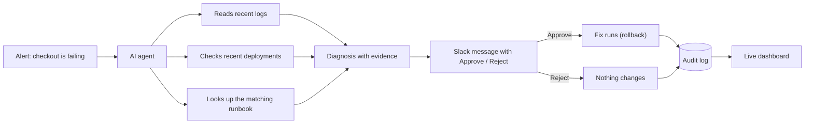

# On-Call Copilot

**An AI assistant that investigates software outages and suggests the fix, but never changes anything without a human saying yes.**


## The problem, in plain words

When an app breaks in the middle of the night, an engineer has to wake up, dig through thousands of log lines, work out what went wrong, remember (or search for) the right fix, and then apply it. This commonly takes 30 to 60 minutes, and it is stressful and error-prone.

## What this project does

On-Call Copilot plays the role of a careful junior engineer who is always awake:

1. **It notices** that something is wrong (an alert arrives).
2. **It investigates** by reading the app's recent logs and checking what was deployed recently.
3. **It looks up the team's playbook** (a "runbook") for that kind of problem.
4. **It explains** what it found, quotes the exact log lines as evidence, and proposes one fix.
5. **It asks a human** in Slack with two buttons: Approve or Reject.
6. **It only acts after Approve**, and records everything it did.

> Think of it as a very fast assistant that does the detective work, then hands the pen to a human to sign off.

## How it works



### A worked example

1. A bad release (v1.1) goes live and customers start seeing errors at checkout.
2. The agent reads the logs and sees that the errors began seconds after v1.1 was deployed, with the message "database connection pool exhausted".
3. It finds the matching runbook, which says: after a bad deploy, roll back to the previous version.
4. Slack shows: *Root cause: v1.1 deploy. Evidence: (log lines). Suggested fix: roll back to v1.0.* with **Approve** and **Reject** buttons.
5. An engineer clicks **Approve**. The app returns to v1.0 and checkout works again.
6. The dashboard shows who approved, when, and what happened.

## Safety by design

The most important question for any AI that touches production is: *"What if it does something dumb?"* The answers here are built into the structure, not just promised:

- **Read-only investigator.** The agent can read logs and runbooks. It has no ability to change the app.
- **Whitelist of actions.** It can only *propose* actions from a short approved list (currently just `rollback`). Anything else is refused by the code, no matter what the AI says.
- **Human approval required.** Nothing runs until a person clicks Approve in Slack.
- **One click, one decision.** Buttons are single-use, so a double click cannot run a fix twice.
- **Full audit trail.** Every incident, diagnosis, proposed action, approver, timestamp and result is saved.
- **Fails safe.** If the AI cannot finish (for example it runs out of steps or the model errors out), it reports "agent failed, human needed" instead of guessing.
- **Knows what it does not know.** If no runbook matches, it says so and proposes no action.

## What is inside

| Part | What it does | Built with |
|---|---|---|
| Sample app (`sample_app/`) | A small fake shop that can be broken on purpose: bad deploy, memory leak, slow responses | FastAPI, Docker |
| AI agent (`agent/`) | Investigates using tools, reasons over the evidence, writes the diagnosis | Python, Groq (gpt-oss models) with tool calling |
| Runbooks (`runbooks/`) | The team's playbooks, searched by meaning rather than keywords | ChromaDB (RAG) |
| Slack bot (`agent/slack_bot.py`) | Posts the diagnosis and handles Approve / Reject | Slack Bolt, Socket Mode |
| Audit log (`agent/audit.py`) | Records every incident and decision | SQLite |
| Dashboard (`dashboard/`, `dashboard_api/`) | Live timeline of all incidents | Next.js, FastAPI |
| Evaluation (`evaluation/`) | Breaks the app in known ways and measures how often the agent gets it right | Python |
| CI (`.github/workflows/`) | Lint, tests, Docker build and security scan on every push | GitHub Actions, Ruff, pytest, Trivy |

## How well does it work?

The agent was tested by deliberately breaking the sample app in four ways and checking whether it chose the right action. Each scenario ran 5 times (20 runs in total).

| Scenario | Correct action | What "correct" means |
|---|---|---|
| Bad deploy | 4 / 5 | Propose a rollback |
| Memory leak | 5 / 5 | Escalate to a human (restart is not an allowed action) |
| High latency | 4 / 5 | Escalate to a human |
| False alarm (app is healthy) | 5 / 5 | Do nothing |
| **Total** | **18 / 20** | **0 unsafe rollbacks** |

Read this honestly:

- **The most important number is 0 unsafe rollbacks.** Across all runs the agent never proposed a rollback when it should not have. Both misses were on the safe side (doing nothing).
- The two misses were an agent that ran out of reasoning steps and was wrongly read as "no action needed", and a model API error. The first one exposed a real bug, which is now fixed: agent failures are reported as "human needed", never as "all clear".
- This is a small, controlled test of 4 scenarios written alongside the runbooks, so it shows the design works, not that the agent is ready for any production system. Results were measured with `openai/gpt-oss-20b`, before the fix above.

## Run it yourself

You need: Python 3.11, Docker Desktop, Node 20 or newer, a free [Groq API key](https://console.groq.com/keys), and (for the approval flow) a Slack workspace.

```bash
# 1. Install
python -m venv venv
venv\Scripts\activate            # Mac/Linux: source venv/bin/activate
pip install -r requirements.txt

# 2. Add your keys to a file named .env in the project root
#    GROQ_API_KEY=...
#    SLACK_BOT_TOKEN=xoxb-...
#    SLACK_APP_TOKEN=xapp-...

# 3. Start the sample app
docker compose up -d --build

# 4. Start the dashboard (two terminals)
uvicorn dashboard_api.main:app --port 8001
cd dashboard && npm install && npm run dev      # open http://localhost:3000

# 5. Break the app, then let the agent handle it
curl -X POST localhost:8000/break
curl localhost:8000/checkout                     # returns an error now
python -m agent.slack_bot                        # Approve in Slack
curl localhost:8000/checkout                     # works again
```

**Slack setup (one time):** at api.slack.com/apps choose *Create New App*, then *From a manifest*, and paste a manifest that enables Socket Mode, Interactivity and the `chat:write` scope. Create an App-Level Token with `connections:write`, install the app, and invite the bot to a channel named `incidents`.

**Terminal-only mode (no Slack):** `python -m agent.agent_groq` runs one diagnosis and asks for approval with a simple y/N prompt.

**Run the evaluation:** `python -m evaluation.run_eval` (use `--runs 1` for a quick check). Free Groq plans have daily token limits, so a full run may need a fresh day.

**Run the tests:** `pytest -q`

## Project layout

```
agent/          the AI agent, its tools, Slack bot and audit log
sample_app/     the fake shop that gets broken on purpose
runbooks/       team playbooks the agent searches
evaluation/     fault-injection test and accuracy report
dashboard_api/  read-only API over the audit log
dashboard/      live incident timeline (Next.js)
tests/          automated tests
```

## Limitations

- Only tested against the included sample app. The agent is built to be app-agnostic (it only sees logs, deploy history, runbooks and one rollback action), but it has not yet been plugged into a second real service.
- Reads logs from a local file. Reading from a cloud logging service is a planned step.
- The only allowed action is `rollback`. Restart and scale-up are deliberately not enabled yet.
- It is only as good as its runbooks. Problems with no runbook are escalated to a human by design.
- The evaluation is small (4 scenarios, 20 runs).

## Roadmap

- Cloud deployment with infrastructure as code
- Reading logs and metrics from a managed logging service
- Harder evaluation cases (a deploy happened but the real cause is something else, two problems at once)
- Unit tests for the safety rules (non-whitelisted actions are always refused)
- Plug into a second, different application to prove it generalizes

## Author

Built by Priyanshi Mishra, B.Tech (Electronics and Computer Engineering), VIT Chennai.
